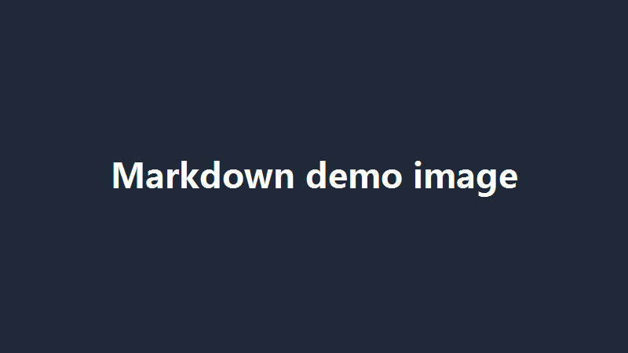

# md

一个用于练习 Markdown 与 Git 的示例仓库。

## 项目说明

本仓库用于验证 Markdown 的常见写法在本地预览与 GitHub 渲染下是否一致，覆盖标题、列表、表格、代码块、链接与图片六类元素。

- 编辑器：VS Code
- 版本管理：Git
- 渲染平台：GitHub

## 目录结构

```text
md\
├── README.md        # 当前文件
└── images\
    └── demo.png     # 示例图片（800×450）
```

## 示例表格

| 工具 | 用途 | 熟练度 |
| :--- | :---: | ---: |
| Markdown | 日常文档 | 熟练 |
| LaTeX | 正式论文 | 入门 |
| Git | 版本管理 | 熟练 |

## 示例代码

```python
def add(a: int, b: int) -> int:
    """返回两数之和。"""
    return a + b


print(add(1, 2))  # 3
```

## 示例列表

1. 创建仓库并初始化 Git
2. 编写 README 与示例图片
3. 提交并推送到 GitHub

- [x] 编写 README
- [x] 添加示例图片
- [x] 首次推送成功
- [ ] 补充更多示例

## 链接与图片

- [VS Code 官网](https://code.visualstudio.com/)
- [Git 官方文档](https://git-scm.com/doc)
- [Markdown 语法指南](https://www.markdownguide.org/)



## 本地预览

在 VS Code 中打开本文件，按 `Ctrl+K` 再按 `V`，右侧即为分屏预览；`Ctrl+Shift+V` 则切换为纯预览。
